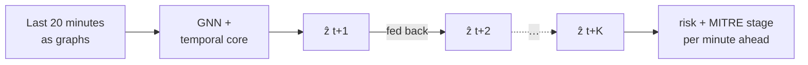
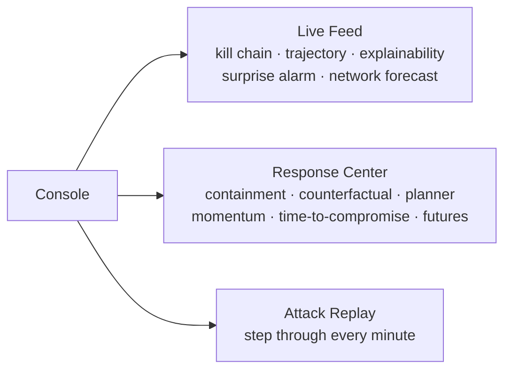
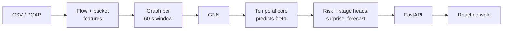

# NeuralShield: Network Attack Forecasting

**SIH 2026 · PS 26153 · National Technical Research Organisation (NTRO)**

| | |
| --- | --- |
| Problem statement | 26153: AI-based network attack forecasting |
| Live demo | https://arrsalan-neuralshield.hf.space |

NeuralShield learns how a network's traffic changes over time and forecasts where an attack is heading,
so an analyst is warned while the attack is still in progress rather than after it has finished.

## The problem

Most intrusion detection labels each flow or time window on its own as benign or malicious. It has no
memory, so it cannot tell a host that has been quietly scanning for five minutes from one that always
talks to many peers. PS 26153 asks for a system that models the network as a changing state, predicts
where that state is going, and flags an attack before the kill chain completes.

## How it works

Every 60 seconds of traffic becomes a graph: hosts are nodes and the traffic between each pair of hosts
is an edge. A graph neural network turns each graph into a compact vector, and a temporal model (an LSTM,
swappable for a Transformer) reads the last 20 vectors and predicts the next one. The attack forecast is
made from that predicted vector, so it is a prediction of the next minute, not a label for the current one.

Because the model predicts its own next state, it can keep going: each prediction is fed back in to
predict the one after, for as many steps as needed, with no future traffic required. This is the world
model idea from Ha & Schmidhuber (2018) and Hafner et al. (2020).



## Result

Tested on **Friday-Afternoon-DDoS** from CIC-IDS2017, which was kept out of training, validation and
normalisation entirely. The model never saw this attack type before the test.

| Model | Accuracy | Precision | Recall | F1 | FPR | ROC-AUC |
| --- | --- | --- | --- | --- | --- | --- |
| **World model** | 0.963 | 0.951 | 0.917 | **0.933** | 0.019 | **0.989** |
| Logistic regression (same features, no time context) | 0.696 | 0.000 | 0.000 | 0.000 | 0.099 | 0.040 |

This is one unseen attack type on one dataset, not a claim that it works on any network.

## The console

Three modes, each answering one question for the analyst. Every panel is computed from the world model's
own outputs; none of them is a separate trained model.



| Panel | What it tells the analyst |
| --- | --- |
| Kill-Chain Forecast | Which MITRE ATT&CK stage the network is in: Reconnaissance, Initial Access, Lateral Movement, Command and Control, Exfiltration, or Denial of Service / Impact |
| Attack Probability Trajectory | Attack risk for every observed minute, then the forecast |
| Explainability | Which connections and traffic features drove the forecast (GNN attention and Input×Gradient attribution) |
| Surprise Alarm | Traffic the model finds unusual compared with normal behaviour, without needing an attack label |
| Network Forecast View | Predicted flow count, ports touched and bytes a few minutes ahead |
| Containment Window | Recommended action, and how long this stage lasted in past attacks |
| Counterfactual Simulator | What happens to the forecast if a host is isolated or a flow is blocked |
| Response Planner | Every isolate and block action, ranked by risk reduction, with the normal traffic each would cut |
| Threat Momentum | How fast the threat is escalating, separate from how severe it is |
| Time-to-Compromise | How soon the attack threshold is likely to be crossed |
| Parallel Futures | The model's uncertainty: where 40 sampled forecasts end up |
| Attack Replay | Every observed and forecast minute, with what the model was watching at each |

## Architecture



| Layer | Technology |
| --- | --- |
| Model | Python 3.12, PyTorch, PyTorch Geometric (about 101K parameters) |
| Data | pandas, NumPy, scikit-learn |
| Traffic processing | Scapy, cicflowmeter |
| API | FastAPI, Uvicorn |
| Frontend | React 19, TypeScript, Vite, Tailwind CSS 4, Recharts |
| Deployment | One Docker container serving the API and the built frontend, on Hugging Face Spaces |

Inference runs fully offline after the model loads, with no external API calls, so it can be deployed
inside a closed network.

## Run it locally

Requires Python 3.12 and Node 18+. PCAP uploads also need `tcpdump` and `libpcap` on the machine
running the backend (`sudo apt install tcpdump libpcap0.8` on Ubuntu).

```bash
# Backend
python3.12 -m venv .venv
./.venv/bin/pip install -r requirements.txt
./.venv/bin/uvicorn api.main:app --reload --port 8000

# Frontend, in a second terminal
cd frontend
npm install
npm run dev   # http://localhost:5173, proxies /api to localhost:8000
```

Open `http://localhost:5173` and upload a CICFlowMeter-style CSV or a PCAP.

| Endpoint | Purpose |
| --- | --- |
| `GET /health`, `GET /model-info` | Liveness and model metadata |
| `POST /analyze` | CSV or PCAP and a horizon K: returns the timeline, forecast, MITRE stage, explanation and every panel above |
| `POST /simulate` | Counterfactual action on the last analysed capture |
| `POST /plan-response` | Ranks every candidate defender action by risk reduction |
| `GET /model-performance/roc-pr`, `/calibration` | Precomputed held-out evaluation data |

## Known limits

- The model was trained on CIC-IDS2017 flow records with packet-level features (TTL, TCP window) left at
  zero, so CSV uploads are more reliable than PCAP uploads until it is retrained with them.
- The forecast is most reliable for the first few steps; long rollouts drift back towards normal traffic.
- The headline result covers one held-out attack type on one dataset.

## Roadmap

1. Retrain with packet-level features (the extraction code is built and tested).
2. Add a second dataset (CTU-13) to measure cross-dataset generalisation.
3. Temperature scaling for better-calibrated probabilities.
4. Live NetFlow/IPFIX ingestion, authentication and multi-session state.

## Project layout

```
features/     flow-level and packet-level extraction, windowing
graph/        graph state per window, ground-truth transitions
models/       world model (GNN + temporal core), forecast decoder
rollout/      K-step rollout, MITRE stage mapping
explain/      attention and gradient attribution
momentum/     Threat Momentum
containment/  Containment Window, Response Planner
futures/      Parallel Futures, Time-to-Compromise
fingerprint/  Attack Fingerprint
surprise/     Surprise Alarm
baseline/     logistic-regression baseline
benchmark/    world model vs. baseline
api/          FastAPI service
frontend/     React console
scripts/      training, benchmarking and data export
configs/      run configuration
tests/        about 196 tests across 21 files
```
